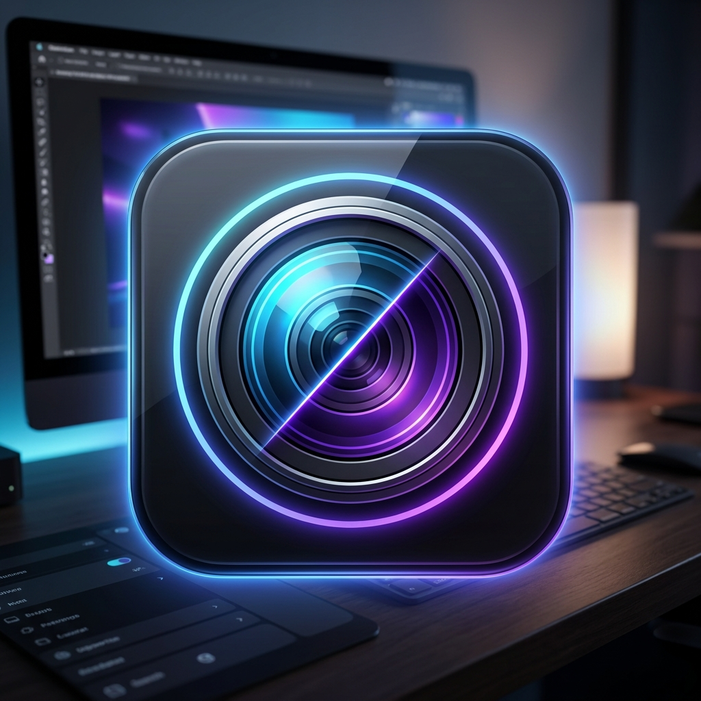

<div align="center">



# MirrorCam Studio

**More Than Just a Webcam.**

*One lens. Infinite frames. Complete creative control over what your camera says on every call.*

[-111827?style=for-the-badge&logo=windows)](https://github.com/stack-rishi/MirrorCam-Studio/releases/download/v1.0.0/MirrorCam.exe)
[](https://github.com/stack-rishi/MirrorCam-Studio/releases/latest)
[](LICENSE)

</div>

---

> *"Your webcam doesn't have to show only your face. Show what you want, the way you want."*

Every video call begins with the same square frame — an un-mirrored, unyielding live feed that often feels backwards when you look at it and rigid when you need something else.

**MirrorCam Studio** reimagines that outgoing camera feed on Windows as an expressive canvas. Whether you want the quiet familiarity of a horizontally mirrored lens, a calm still photograph while you step away, a looping visual composition, or an animated GIF timed to the moment, MirrorCam routes your chosen medium straight into **WhatsApp Desktop**, **Discord**, **Zoom**, **Google Meet**, and **Microsoft Teams**.

---

## Philosophy & Craft

Built to feel lightweight yet intentional, MirrorCam bridges the gap between simple webcam utilities and heavy broadcast suites:

- **Natural Reflection (Live Mirroring)**  
  Horizontally invert your physical camera in real time so notes, sketches, gestures, and expressions align with how you see yourself in a mirror.

- **Media-as-Camera Composition**  
  Transform static artwork and photography (`.png`, `.jpg`, `.jpeg`, `.webp`, `.bmp`, `.tiff`), seamlessly looping video reels (`.mp4`, `.mkv`, `.avi`, `.mov`, `.wmv`, `.webm`, `.flv`), or frame-accurate animated `.gif` loops directly into a live virtual camera signal.

- **Precision Geometry & High-DPI Fidelity**  
  Designed with Windows Per-Monitor V2 DPI awareness so every control renders razor-sharp on scaled displays. Automatically detects your monitor's native resolution and aspect ratio (`16:9`, `16:10`, `4:3`), applying clean letterboxing and bicubic interpolation so your frame never arrives stretched or blurred.

- **Seamless Windows WhatsApp Desktop Bridge**  
  Includes a dedicated, distraction-free **Clean Feed** pop-out paired with hands-free background automation for OBS Studio and DroidCam Virtual Output — bypassing the Microsoft Store camera sandbox in a single click.

---

## Signal Flow

```text
  [ Physical Webcam ]  ───┐
  [ Static Photo    ]  ───┼──>  MirrorCam Studio  ──>  Mirror / Fit / Bicubic Scale
  [ Looping Video   ]  ───┤
  [ Animated GIF    ]  ───┘
                                       │
                   ┌───────────────────┴───────────────────┐
                   ▼                                       ▼
         OBS Virtual Camera                     High-Res Clean Feed
            (DirectShow)                                   │
                   │                                       ▼
                   │                              OBS Window Capture
                   │                          (DroidCam Virtual Output)
                   ▼                                       ▼
   Discord · Zoom · Meet · Teams              Windows WhatsApp Desktop
       & WhatsApp Web (Browser)                (WinRT / Media Foundation)
```

---

## Designed For

| Audience | How MirrorCam Fits In |
|---|---|
| **Students & Presenters** | Share visual cards, title slates, or mirrored demonstrations smoothly during online classes and seminars. |
| **Remote Professionals** | Keep meetings natural with mirrored camera framing or switch cleanly to a curated still image between sessions. |
| **Creators & Storytellers** | Turn photography, ambient motion loops, and visual artwork into a living webcam presence. |
| **Gamers & Communities** | Drop reaction GIFs and custom video loops directly into Discord channels as a real camera feed. |

---

## Getting Started

### 1. Prerequisite Driver
MirrorCam uses the virtual camera infrastructure provided by **[OBS Studio](https://obsproject.com/)**. Install OBS Studio once on Windows. For Discord, Zoom, Google Meet, Microsoft Teams, and WhatsApp Web, you do not need to configure or open OBS yourself.

### 2. Download & Launch
1. Download **[MirrorCam.exe](https://github.com/stack-rishi/MirrorCam-Studio/releases/download/v1.0.0/MirrorCam.exe)** from the [Releases](https://github.com/stack-rishi/MirrorCam-Studio/releases/latest) page.
2. Run `MirrorCam.exe` — no Python runtime or dependency installation is required.
3. Select an input source:
   - **Physical Webcam** (`Camera Index` `0`, `1`, etc.), or
   - **Media File** (any photo, video, or animated GIF).
4. Adjust **Resolution** (or click **Match Screen** to lock onto your display's native dimensions and aspect ratio) and **Mirror output**.
5. Click **Start Stream**.

---

## Connecting to Calling Platforms

### Discord, Zoom, Google Meet & Microsoft Teams
1. Start your stream inside MirrorCam Studio.
2. Open **Video Settings** inside your calling application and select **`OBS Virtual Camera`**.

> [!TIP]
> If your calling app applies its own local self-view mirror toggle, disable that toggle so MirrorCam remains your single source of truth.

---

### Windows WhatsApp Desktop (Microsoft Store App)

> [!NOTE]
> Unlike Win32/Electron apps such as Discord, the Microsoft Store edition of Windows WhatsApp runs inside an AppContainer sandbox and queries only modern WinRT/Media Foundation kernel drivers (`KSCATEGORY_CAPTURE`). MirrorCam bridges this cleanly through OBS Studio and the **DroidCam Virtual Output** driver.

#### One-Time Setup
1. Install the free **DroidCam OBS Virtual Output** drivers and plugin from the [dev47apps releases](https://github.com/dev47apps/droidcam-obs-virtual-output/releases) (`DroidCam.Drivers` and `DroidCam.OBSVirtualOut.Plugin`), then restart Windows once.
2. Open **OBS Studio**, add a **Window Capture** source under **Sources**, and select **`MirrorCam Clean Feed`**. Right-click the source and choose **Transform -> Fit to Screen**. OBS remembers this scene permanently.

#### Daily Hands-Free Workflow
1. Launch **MirrorCam Studio** with **Auto-connect OBS (hands-free)** enabled.
2. Click **Start Stream** — MirrorCam opens the full-resolution Clean Feed, launches OBS silently in the background if closed, activates DroidCam Virtual Output, and minimizes OBS away.
3. Choose **`DroidCam Video`** inside WhatsApp Desktop.

> [!TIP]
> Prefer zero additional plugins? Open **[web.whatsapp.com](https://web.whatsapp.com)** in Chrome or Edge — browser sessions recognize **`OBS Virtual Camera`** natively.

---

## Developer Guide & Command-Line Interface

You can run MirrorCam directly from Python source or drive streams headlessly from the terminal.

### Local Setup
```powershell
git clone https://github.com/stack-rishi/MirrorCam-Studio.git
cd MirrorCam-Studio
pip install -r requirements.txt
```

### Launch Desktop Studio
```powershell
python mirrorcam_gui.py
```

### Command-Line Streaming (`camera.py`)
```powershell
# Match primary display resolution and aspect ratio automatically
python camera.py --match-screen

# Stream physical webcam at 1080p, 30 FPS
python camera.py --camera 0 --width 1920 --height 1080 --fps 30

# Stream a looping video, still image, or animated GIF
python camera.py --file path/to/loop.mp4
python camera.py --file path/to/frame.png
python camera.py --file path/to/motion.gif

# Disable horizontal flip or suppress the local preview window
python camera.py --file path/to/loop.mp4 --no-mirror --no-preview
```

### Package Standalone Executable
```powershell
pip install pyinstaller
pyinstaller MirrorCam.spec --noconfirm
```
The compiled binary outputs to `dist/MirrorCam.exe`.

---

## Repository Layout

```text
MirrorCam-Studio/
├── mirrorcam_gui.py     # High-DPI Windows GUI, Clean Feed window & OBS automation
├── camera.py            # Headless CLI streamer for webcams, photos, videos & GIFs
├── activate_obs.py      # Standalone OBS + DroidCam activation utility
├── activate_obs.bat     # Quick Windows launcher for activate_obs.py
├── MirrorCam.spec       # PyInstaller build configuration
├── app_icon.ico         # Windows executable icon
├── app_icon.png         # MirrorCam Studio emblem
├── requirements.txt     # Runtime dependencies (opencv-python, pyvirtualcam, pillow)
├── LICENSE              # MIT License
└── README.md            # Documentation
```

---

## Troubleshooting

- **Virtual camera does not appear in your call app**  
  Confirm OBS Studio is installed, click **Start Stream** in MirrorCam first, and reopen your calling app's device list.
- **WhatsApp Desktop displays only the built-in webcam**  
  Ensure both the DroidCam drivers and OBS plugin are installed and that Windows has been restarted once since installation.
- **Camera index fails to open (`Could not open camera index 0`)**  
  Close other apps currently holding your physical camera (such as Windows Camera, Zoom, or Discord) or switch **Camera Index** to `1`.
- **Outgoing feed looks reversed**  
  Verify **Mirror output (Flip horizontally)** is enabled in MirrorCam and turn off any duplicate self-view mirror setting inside your calling app.

---

<div align="center">

*"Don't just join the call. Make your camera yours."*

Licensed under the [MIT License](LICENSE).

</div>
